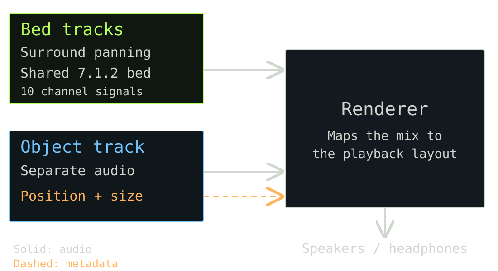
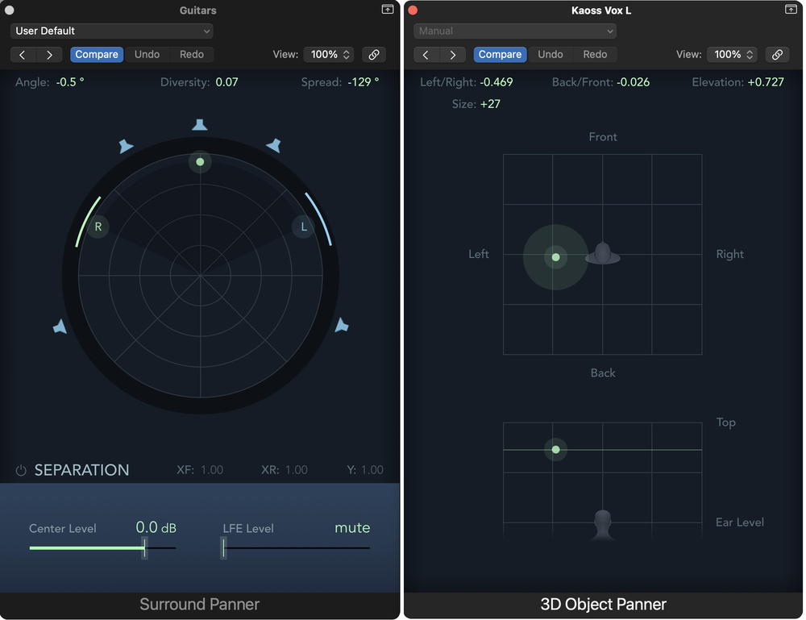

+++
title = "Dolby Atmos"
outputs = ["Reveal"]
[reveal_hugo]
margin = 0.2
+++

# Dolby Atmos

Audio, position metadata, and a renderer

{}
Atmos separates object audio and spatial intent from a fixed playback layout.
Beds carry channel-based audio; objects carry audio and separate position
metadata. The renderer combines them for a monitoring or playback system.

Connect this lesson to the 7.1 REAPER mix before introducing new software.
Students should be able to trace both signal paths, justify a bed/object choice,
and distinguish an ADM master from a rendered listening file.
{}

---

## Our REAPER mix was channel-based

* ReaSurroundPan distributed audio among eight channels
* Automation changed that distribution over time
* The exported 7.1 WAV stored those channel signals
* An Atmos object keeps audio and position metadata separate

{}
Recall one movement from Wednesday's mix. REAPER stored the panner automation
in the session, but the 7.1 render contained the resulting eight audio channels.
An Atmos master can retain object audio and its pan metadata for later rendering.
ReaSurroundPan alone does not create an Atmos master.

Both workflows can move sounds. The difference is what the master preserves,
not whether a source moves.
{}

---

## Bed format and speaker layout

| Format | Channels | Role in this course |
| --- | --- | --- |
| 7.1 | 8 | Our REAPER mix and room playback |
| 7.1.2 | 10 | Our Logic Atmos bed |
| 7.1.4 | 12 | A monitoring layout with four height channels |

The bed format and monitoring format are separate choices.

{}
The first number counts main ear-level channels, .1 is LFE, and the last
number counts height channels. LFE is a signal channel, not a count of physical
subwoofers. A channel is a signal; a speaker is a transducer.

Logic offers one shared bed, selectable as 5.1, 7.1, or 7.1.2. We will use 7.1.2.
Its top-middle pair cannot carry separate front-height and rear-height signals.
The renderer maps the bed and objects to the chosen monitoring layout.
A 7.1.4 monitoring setting does not turn the bed into a 7.1.4 bed or create
physical height speakers in our 7.1 room.
{}

---

## Beds and objects

* **Bed:** tracks combine into a channel-based submix
* **Object:** audio stays separate, with position and size metadata
* Either can contain stationary or moving sounds
* A stereo object track uses two object inputs

{}
In Logic at 48 kHz, the usual budget is a ten-channel 7.1.2 bed plus up to
118 mono object inputs, 128 input channels in total. Do not confuse this with
the number of playback speakers. A stereo object track consumes two inputs.

A bed is useful for material that should share a channel-based bus. Objects
are useful for independent placement, size, or binaural metadata, including
stationary sources. A bed track's panner can also be automated.

Ambisonics, used in Project 3, encodes a sound field for decoding. Atmos uses
bed audio, object audio, and metadata. Both can adapt to a playback layout,
but they preserve spatial information differently.
{}

---

## Two paths into the renderer

Simplified course diagram. <a href="https://www.eventideaudio.com/blog/atmos-demystified/">Eventide routing reference</a> · <a href="https://support.apple.com/en-au/guide/logicpro/lgcp73f9b9ac/mac">Logic signal paths</a>

{}
Trace the object path at bottom left: the audio reaches the renderer without being
mixed into the bed, while location, size, and movement travel as metadata.
Trace the bed path at top left: its panner distributes audio into the
shared 7.1.2 bed. The renderer receives both paths and creates the outputs.

The output represents either a speaker render or a binaural headphone render,
not a required speaker count.
In Logic, the renderer is the Dolby Atmos plug-in. Object tracks bypass the bed
bus, so processing placed on that bus before the renderer does not automatically
process objects. Logic allows mono or stereo object tracks, not surround objects;
the object panner has no direct LFE send.
{}

---

## Rendering for the playback system

* Bed channel signals and object metadata enter the renderer
* The renderer creates outputs for the selected layout
* Headphones require binaural rendering
* Different playback systems still need listening checks

{}
A fixed downmix matrix works from channel signals. Atmos rendering also uses
object position, size, and movement. Spatial information may be encoded and
packaged differently for consumer distribution; an ADM master is not the same
file as a streaming encode.

Rendering cannot guarantee identical sound on every device. Placement, room
acoustics, virtualization, and the renderer affect the result. A speaker render
with no height outputs can include sounds positioned overhead, but it cannot
reproduce discrete overhead speakers that are not present.
{}

---

## Ambisonics and Atmos

| | Ambisonics | Atmos |
| --- | --- | --- |
| Stores | Encoded sound-field components | Bed audio, object audio, metadata |
| Positions | Encoded into component signals | Object positions stored separately |
| Playback | Decode for speakers or headphones | Render for speakers or headphones |

Both can preserve height and adapt to different playback layouts.

{}
Recall Project 3: source > ATK encoder > B-format mix > decoder > outputs.
The four channels of full-sphere first-order B-format are sound-field components,
not four speaker feeds. Higher orders use more components for greater spatial
detail. Channel order and normalization must match the decoder; our ATK workflow
uses FuMa conventions, while AmbiX uses a different ordering and normalization.

For Atmos: bed audio plus separate object audio and position metadata > renderer
> outputs. An object channel is also not a speaker feed. Neither format requires
one fixed playback speaker count, and both can produce binaural headphone audio.
Playback flexibility does not guarantee equal localization on every system.

Ambisonics is not just a microphone technique: you can encode and automate
individual sources, as in Project 3. Atmos is not just a larger surround layout.
The distinction here is how the spatial scene is represented and retained.
{}

---

## One bird, one background

* **Ambisonics:** encode the bird and traffic into a shared field
* **Atmos:** keep the bird as an object; place the traffic in the bed
* Rotate an Ambisonic mix and the whole field turns
* Move the Atmos bird object and its background can stay put

What would you need to move only the bird in a finished Ambisonic mix?

{}
Use the bird and traffic example from the Ambisonics introduction. In the
Ambisonic session, the bird can move independently at its encoder before it
joins the shared field. But a single mixed B-format master no longer retains
that bird as a separately addressable source. Return to the source session or
keep separate Ambisonic stems to revise it independently; rotating the finished
field rotates the traffic too. Directional processing of a field is possible,
but it is not the same as retrieving an isolated bird track.

In the Atmos master, an object retains separate audio and metadata, so a
compatible authoring tool can revise its placement independently of the bed.
Sounds already combined in the bed are not separately recoverable either.
A source's independent editability depends on what you preserve in the master
or stems, not whether it was originally recorded with a particular microphone.

This is a workflow comparison, not a ranking. Ambisonics suits captured or
constructed sound fields and field transformations; Atmos suits bed/object
authoring and its delivery ecosystem. Both can mix recorded ambience with
separately recorded sounds and both can animate spatial placement.
{}

---

## Listen to one placement change

1. Hear a short excerpt with one object held in place
2. Hear it again with one deliberate movement
3. Compare a 7.1 speaker render with a binaural preview
4. Describe what stayed clear and what changed

{}
Use a prepared Logic Atmos session and the same short excerpt at similar
listening loudness. Keep every other mix choice unchanged. Monitor through
the actual verified room layout, then use headphones for the binaural preview.
Do not play a binaural signal through the room and label it a discrete surround
comparison. If headphones are unavailable, make the speaker comparison and
reserve the binaural check for the next listening lesson.

Ask whether the movement helps musical phrasing or draws unwanted attention.
An object does not have to move to justify its use.
{}

---

## Two panners in Logic

{}
The Surround Panner routes a bed track among the selected bed channels. Its
controls refer to that channel layout. The 3D Object Panner describes position
and size independently of a particular speaker layout. Stereo objects add Spread.
Both can be automated. Point to the controls for one stationary placement and
one movement; save the full session-setup procedure for the Logic workshop.
{}

---

## Choose a path and explain why

* A lead vocal that stays in front
* A sound effect that moves overhead
* A diffuse ambience or reverb return

Which would you put in the bed or an object? What control do you need?

{}
Accept more than one defensible answer. The stationary vocal can be an object
for independent positioning and binaural settings, or a bed track when its
channel-based routing serves the mix. An overhead movement benefits from an
object's height positioning. An ambience might share the bed or use objects
for a particular spatial design.

Counterexample: automate a bed track from left to right. It moves, but remains
a bed track. Check that students can explain the routing rather than sorting
sounds solely into static and moving categories.
{}

---

## Binaural monitoring

* Dolby Renderer modes: Off, Near, Mid, Far
* Off includes the sound without distance modeling
* LFE is fixed to Off in Logic
* Apple Renderer has Music and Movie previews

{}
Dolby's binaural settings apply to bed channels and objects in the Dolby
headphone renderer; the LFE setting cannot be changed. They do not affect
Logic's Apple Renderer. Apple Music and Apple TV headphone previews use Apple's
virtualization. Supported devices can add head tracking and personalization.
These are monitoring choices, not additional bed channels. Compare previews
rather than assuming one headphone render represents every service.
{}

---

## A master and a listening file

* **ADM BWF:** bed audio, object audio, and metadata
* **Rendered WAV:** a particular channel layout or binaural preview
* **Playback encode:** a service or device delivery format
* Project 4 requires the Logic project and ADM BWF

{}
An ADM BWF is a multichannel WAV container, but its channels hold bed and object
audio, not simply a finished 7.1.4 speaker render. The metadata is essential.
Changing the filename of a surround WAV does not make it an Atmos master.

In Logic use File > Export > Project as Spatial Audio and choose Dolby Atmos
ADM BWF. The monitoring format does not change that master export. Check it
by opening it in a new project. Delivery requirements vary by recipient; the
later delivery lesson covers levels, format checks, and headphone QC.
{}

---

## References: routing and monitoring

* [Apple: bed tracks and object tracks](https://support.apple.com/en-au/guide/logicpro/lgcp73f9b9ac/mac)
* [Apple: 3D Object Panner parameters](https://support.apple.com/en-au/guide/logicpro/lgcpa01bed87/mac)
* [Apple: monitoring formats](https://support.apple.com/en-au/guide/logicpro/lgcp179f27c1/mac)
* [Apple: binaural render modes](https://support.apple.com/en-au/guide/logicpro/lgcp789f000d/mac)
* [ATK: encoders, transforms, and decoders](https://www.ambisonictoolkit.net/documentation/reaper/)
* [Eventide: Atmos diagram and overview](https://www.eventideaudio.com/blog/atmos-demystified/)

---

## References: masters and delivery

* [Apple: export an Atmos ADM BWF](https://support.apple.com/en-au/guide/logicpro/lgcp258ed132/mac)
* [Apple Music: delivering Dolby Atmos audio](https://itunespartner.apple.com/music/support/5216-delivering-dolby-atmos-audio)

---

## Appendix: other Atmos tools

* Pro Tools Studio and Ultimate: integrated or external renderer
* Nuendo: internal authoring and external-renderer support
* [Dolby Atmos Composer](https://fiedler-audio.com/dolby-atmos-composer/): adds Atmos authoring to other DAWs

{}
Fiedler's Beam plug-in connects DAW tracks to Composer. The full Composer
version also hosts OBAM processing across the Atmos master; Essential has a
smaller feature set. These are alternative tools for the same production
concepts, rather than additional formats to deliver for Project 4.
{}

---

## Appendix: other immersive formats

* MPEG-H Audio: channels, objects, scenes, and listener interactivity
* IAMF: an open, codec-agnostic specification; Eclipsa Audio is based on it
* ASAF and APAC: Apple's production format and delivery codec

{}
MPEG-H can offer producer-authorized dialogue levels, language choices, or
alternate sports commentary. Sony 360 Reality Audio uses MPEG-H Audio.

Eclipsa Audio appears in parts of the YouTube and Samsung ecosystem. Apple's
ASAF/APAC workflow is associated with Apple Immersive Video; it is separate
from the Dolby Atmos music workflow used by Apple Music.
{}

---

## Appendix references

* [Avid: Pro Tools renderer FAQ](https://kb.avid.com/pkb/articles/Knowledge/Pro-Tools-and-the-Dolby-Atmos-Renderer-FAQ)
* [AOMedia: IAMF](https://aomedia.org/specifications/iamf/)
* [Fraunhofer: MPEG-H Audio](https://www.iis.fraunhofer.de/en/ff/amm/broadcast-streaming/mpegh-audio-production-tools.html)
* [Apple: ASAF and APAC](https://developer.apple.com/videos/play/wwdc2025/403/)
